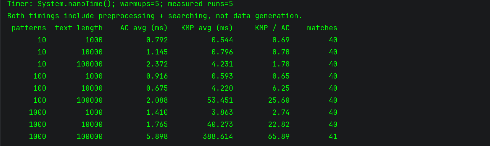

# Aho-Corasick vs KMP in Java

## 1. Project overview

This project implements the **Aho-Corasick** multi-pattern searching algorithm and compares it with running **KMP** once for every pattern. I built a trie, added failure and output links, tested the code, and measured the execution time for different input sizes.

I used **Java 21**, and the project has no external dependencies.

## 4. How Aho-Corasick works

**Trie:** I insert all patterns into one tree. Each edge is a character, and patterns with the same prefix share nodes. At each terminal node I save the IDs of patterns ending there, so duplicate patterns can also be counted independently.

**Failure links:** I use BFS to calculate failure links. A failure link points to the state for the longest proper suffix of the current path that is also a trie prefix. Instead of moving backward in the text after a mismatch, the algorithm follows this information.

**Output links:** A longer matched string can end with another pattern. Output links go to the closest pattern-ending state on the failure chain. They let me report all matches, including suffix patterns and overlapping matches, without copying output lists to every state.

**Searching:** I read the text once from left to right. For every character I update the automaton state. If a pattern ends at this state (or at a state reached by output links), I record its pattern ID and start index.

The code automatically builds an alphabet from all pattern characters. It creates a **completed transition table**: a missing trie edge is replaced with the appropriate transition of the failure state. This allows one transition per text character during searching. The search is case-sensitive, and the positions are Java UTF-16 offsets.

## 5. Complexity analysis

Definitions:

- `k` = number of patterns.
- `m` = total length of all patterns (sum of pattern lengths).
- `n` = length of the text.
- `z` = total number of matching occurrences.
- `sigma` = number of distinct characters in the patterns.
- `Lmax` = length of the longest pattern.

| Operation | Aho-Corasick (this implementation) | KMP (run separately for each pattern) |
|---|---|---|
| Preprocessing | O(m * sigma) time | O(m) time total |
| Searching | O(n + z) time | O(k * n + z) time |
| Total time | **O(m * sigma + n + z)** | **O(m + k * n + z)** |
| Working memory, excluding matches | O(m * sigma) | O(Lmax) if LPS arrays are reused one at a time |
| Saved results | O(z) | O(z) |

Why? There are at most `m + 1` trie nodes. My implementation stores a transition array with `sigma` positions for each node and completes all transitions during BFS, which takes O(m * sigma) time and memory. The pattern length array and terminal pattern IDs take O(m + k) space and fit inside this bound for nonempty patterns. After preprocessing, one text character causes one automaton transition; output traversal takes time proportional to the reported matches. Hash-map character lookup is expected O(1).

For a small fixed alphabet, `sigma` is constant, so this is normally described as O(m + n + z) time. With KMP, each pattern needs its own scan of the text, so the scan cost is multiplied by `k`.

## 6. Testing method

I ran the following **nine combinations**:

- Number of patterns: **10, 100, 1,000**.
- Text lengths: **1,000, 10,000, 100,000** characters.
- Pattern lengths were randomly generated from **5 to 10** lowercase English letters.
- Fixed seeds keep the inputs reproducible. I inserted up to 40 known occurrences into each text so that the algorithms had real matches to report. The largest input also has one naturally occurring match.

For every combination, I performed **5 unmeasured warm-up runs** and **5 measured runs**. I measured time with `System.nanoTime()` and computed the arithmetic average of the five times, converted from nanoseconds to milliseconds.

**Fair comparison:** Both times include preparation and searching: Aho-Corasick builds its trie/links, while KMP builds each LPS array and scans the text for each pattern. Generating random input, warm-up runs, result sorting and correctness comparisons are **outside** the measured time. The execution order changes between runs. Both algorithms must report exactly the same `(pattern ID, start index)` pairs.

The benchmark was run on **OpenJDK 21.0.12.1**, Linux x86_64, using an Intel Xeon Platinum 8573C virtualized environment. CPU scheduling, JVM JIT compilation and garbage collection can influence short timings. These numbers are only for this run; another computer can produce different averages.

## 7. Experimental results

Times below are averages of five measured runs, in milliseconds.

The original measured values for every run are in `results.csv`, and the calculations for this table are in `results_summary.csv`. The `KMP / Aho` column shows how many times longer KMP took; values smaller than 1 mean KMP was faster.

## 8. Discussion and comparison

For only a few patterns, KMP can be as fast as or faster than Aho-Corasick, because the trie and transition table need extra setup. For example, for 10 patterns and 10,000 characters, KMP was slightly faster in this run. Short measurements can be noisy, so small differences should not be treated as universal.

With a larger pattern set, the advantage of Aho-Corasick became clear. For 1,000 patterns and 100,000 text characters, Aho-Corasick averaged **4.570 ms**, while KMP averaged **276.815 ms**. In this test, Aho-Corasick was about **61 times faster**. KMP had to scan the same text 1,000 times; Aho-Corasick scanned it once.

**Aho-Corasick advantages:** good for many patterns; one scan; shared prefixes; finds overlapping and suffix matches. **Limitations:** more preprocessing, more memory for trie/links/transition arrays; the structure must be rebuilt if patterns change in this version.

**KMP advantages:** simple, low auxiliary memory for one pattern, and O(n + pattern length) for one search. **Limitations:** when many patterns are searched independently, the text is scanned repeatedly. If there are only one or two patterns, KMP can be a practical choice.

## 9. Conclusion

In my experiments, Aho-Corasick worked especially well when the number of patterns increased. KMP is useful for searching one pattern, but Aho-Corasick is usually the better choice for searching hundreds or thousands of patterns in the same text. The results support the complexity analysis, although actual times also depend on Java and the computer used.
